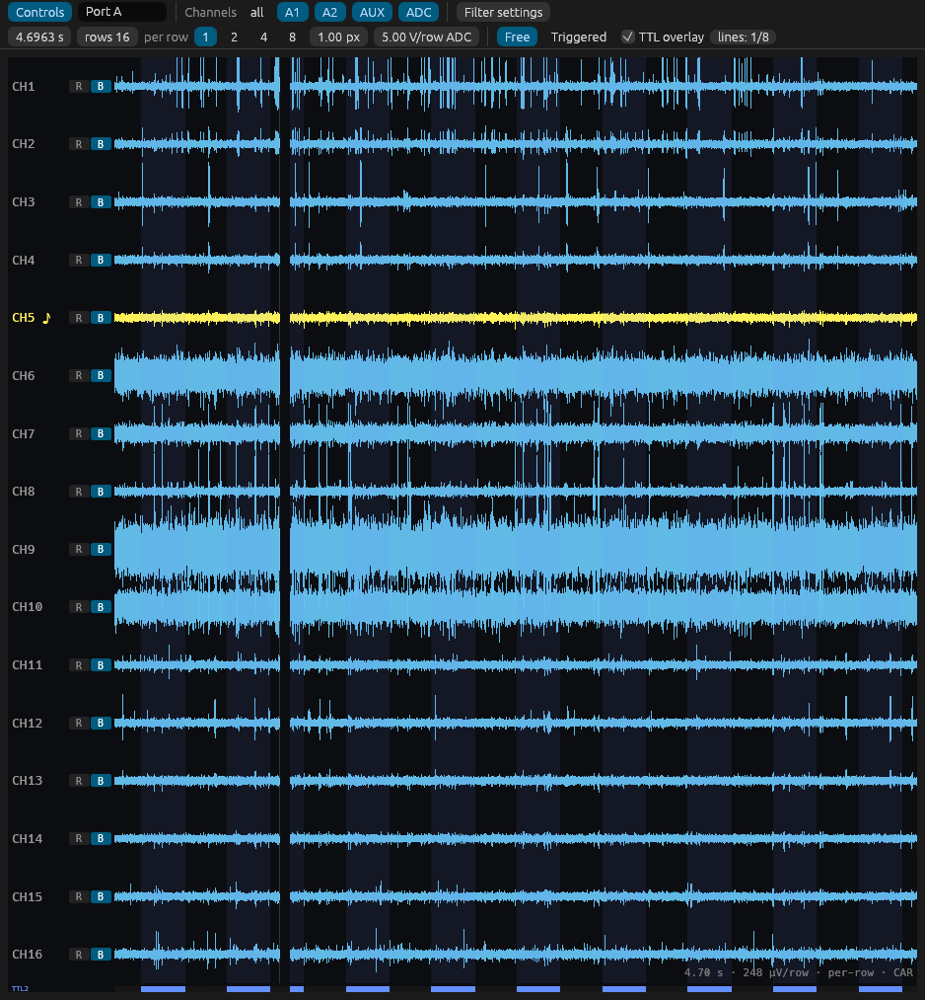
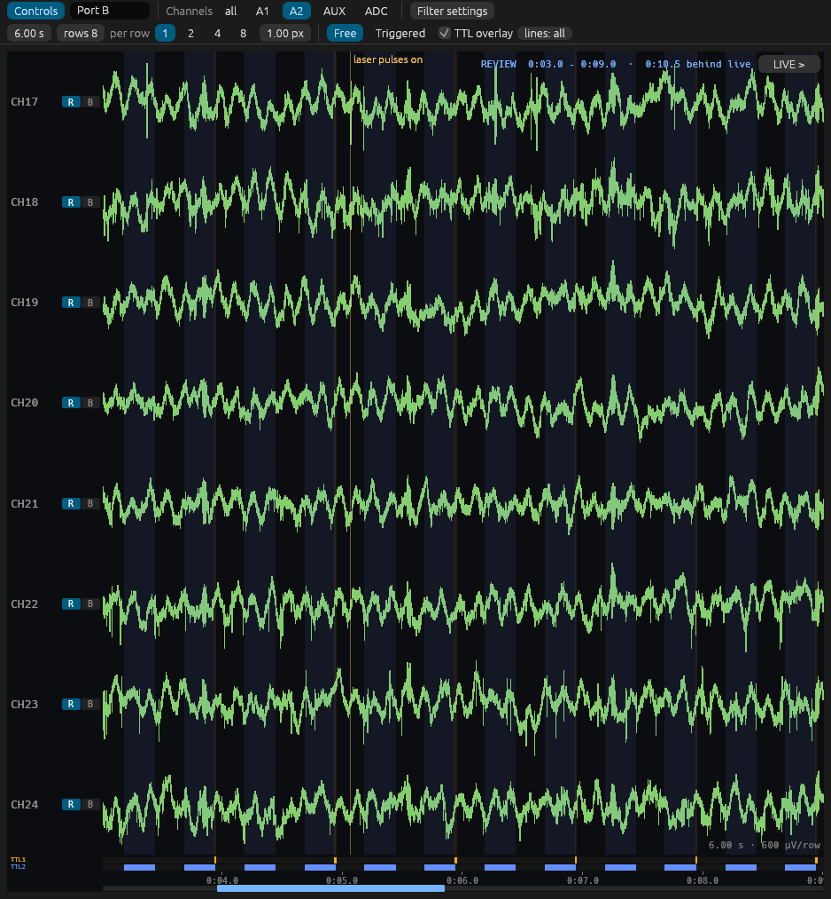
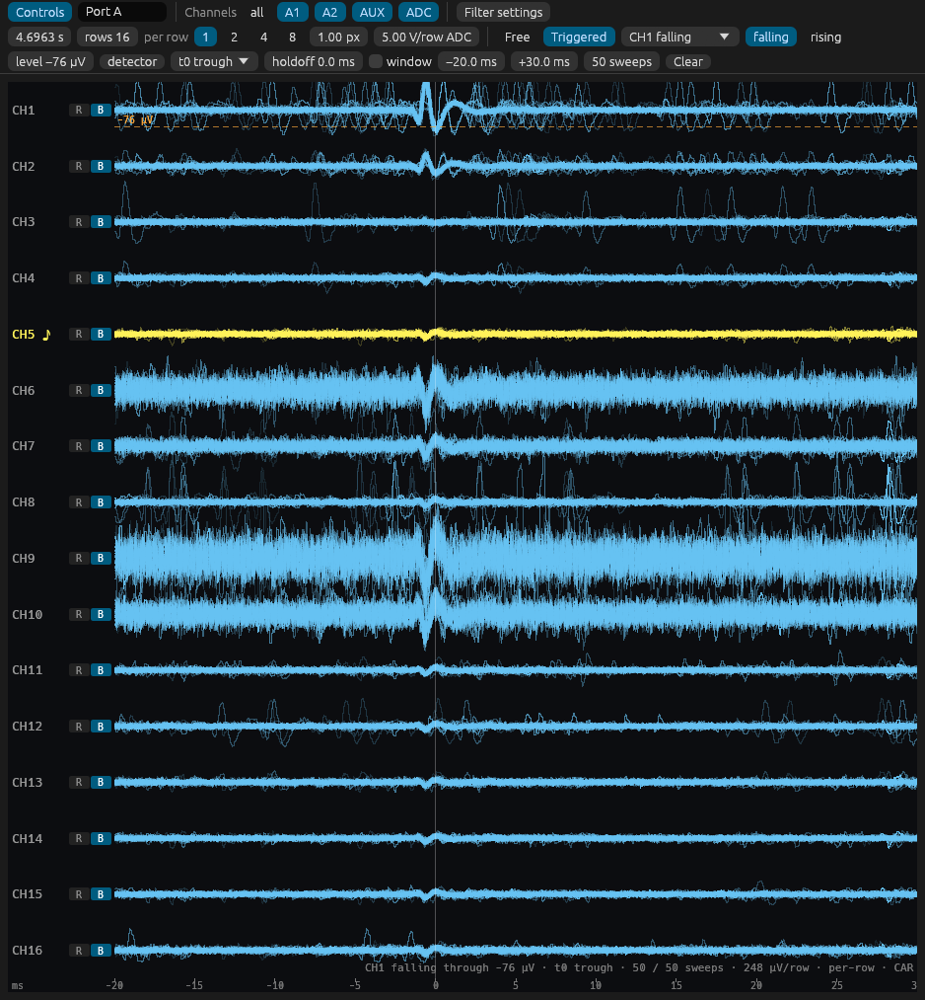
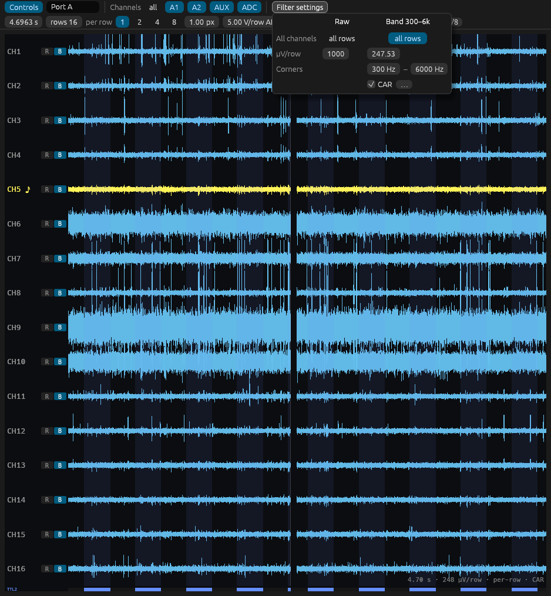
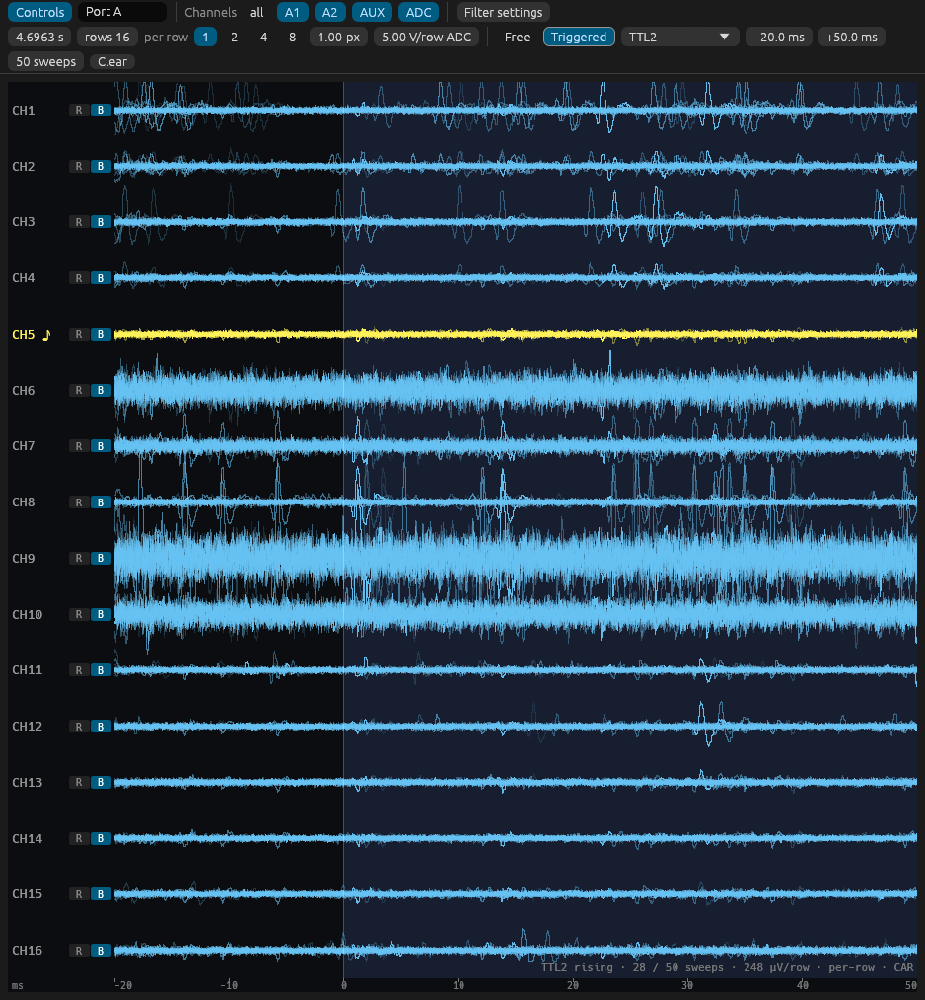
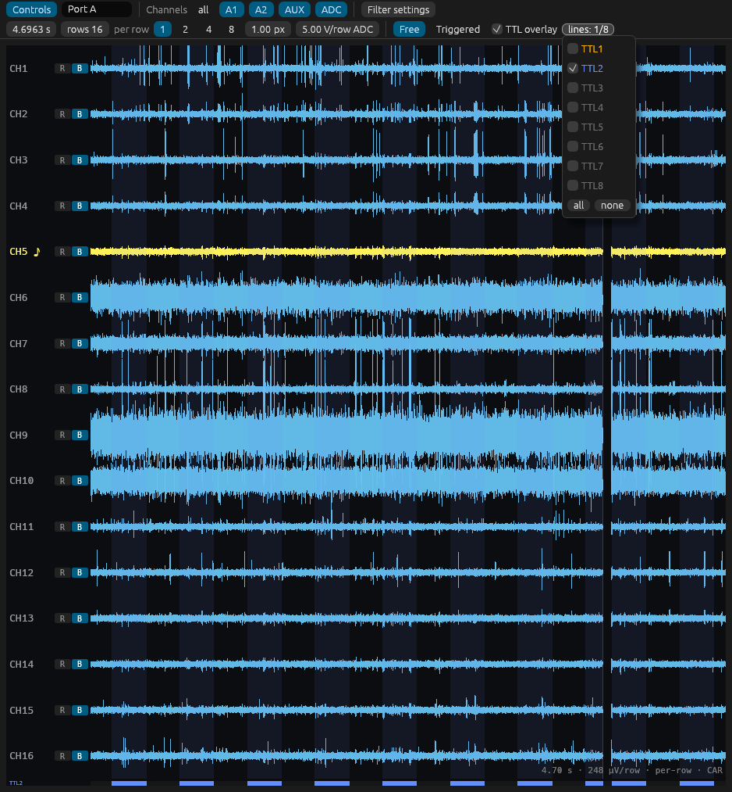
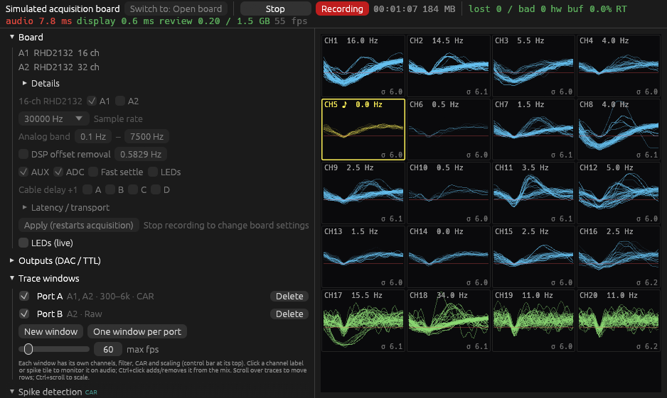

<p align="center">
  
</p>

# kalila — Open Neural Acquisition in Rust

Software for recording from the Open Ephys **ONI/FT600 acquisition board**
(ECP5 gateware, not Opal Kelly), with a GPU-drawn egui interface and a spike-oriented audio
monitor. Rust everywhere except the vendored C `liboni`. The board's FT600 USB chip is driven
by kalila's own code (`crates/ft600`), so FTDI's closed-source D3XX library is not needed
(it remains available as a fallback).

| | |
|---|---|
|  |  |
| **Live traces** (one window per port): 300–6k band with common-average reference, TTL lane underneath, the audio-monitored channel in yellow. | **Scroll-back review** of the ongoing recording: drag back in time, a typed note marker, TTL lanes, the overview strip and how far behind live. |
|  |  |
| **Triggered sweeps** on a spike threshold crossing (drag the dashed level line), every row at the same moment. | **Raw or Band per row**, the band's corners, µV/row and CAR in one palette. |
|  |  |
| **Sweeps on a TTL edge** (here the laser line, TTL2), shaded while the line is high, for opto-tagging. The simulated units don't respond to the laser. | **Pick the TTL lines** the overlay shows, e.g. hide a camera trigger. |



**Main window:** board, recording and trace-window controls, spike tiles with persistence.
All screenshots are from the built-in simulator (`kalila --sim`), so the signals are synthetic.

```
crates/oni-sys   liboni 4.6 (C, vendored, statically linked) + FFI
crates/ft600     FT600 USB driver without D3XX (the default; KALILA_DRIVER=d3xx for the old one)
crates/rhythm    board driver (port of AcqBoardONI/Rhd2000ONIBoard), frame parser, simulator
crates/engine    real-time acquisition thread, recorder (Open Ephys Binary), DSP, audio
app/             egui + wgpu (Vulkan) GUI: GPU traces, GPU spike persistence view
scripts/         udev rule, realtime limits, D3XX driver build (fallback)
packaging/       desktop launcher, icon, release build and packages (CI)
```

## Install

Releases (<https://github.com/matthewperkins/kalila/releases>) have, for Linux on x86_64:

| file | for |
|---|---|
| `kalila_<version>_amd64.deb` | Debian 12+, Ubuntu 24.04+ (PipeWire 0.3.50 or newer) |
| `kalila-<version>.x86_64.rpm` | RHEL / Alma / Rocky 9+, Fedora |
| `kalila-<version>-x86_64-linux-gnu.tar.gz` | any distribution with glibc 2.34 or newer |
| `kalila-<version>-x86_64-linux-musl.tar.gz` | musl distributions (Alpine, Void musl) |

Each is built and then installed and run (on the simulated board) on those distributions by
the release workflow (`.github/workflows/release.yml`). The packages install `kalila`,
`kalila-headless` (acquisition and recording without windows), a menu entry, the board's
udev rule and real-time limits for the `realtime` group; see the package description, or
`INSTALL.md` in a tarball. `SHA256SUMS` has the checksums.

### macOS (Apple silicon)

`kalila-macos-arm64.zip` holds `kalila.app`. It needs nothing installed: no Rust, no
Homebrew, no driver. In Terminal:

```zsh
cd ~/Downloads && curl -L -O https://github.com/matthewperkins/kalila/releases/latest/download/kalila-macos-arm64.zip \
  && unzip -o kalila-macos-arm64.zip && mv kalila.app /Applications/
```

Then open kalila from Launchpad, Spotlight or the Dock.

- **The simulated board** (no hardware): `open -a kalila --args --sim --acquire`, or
  "Switch to" at the top left of the window.
- **Downloaded with a browser instead?** macOS then marks the app as from an unidentified
  developer (it is signed ad hoc, not with a paid Apple Developer ID) and will not open it
  at first. Either right-click the app → Open, once; or System Settings → Privacy &
  Security → Open Anyway; or `xattr -dr com.apple.quarantine /Applications/kalila.app`.
  `curl` does not mark the file, so the line above needs none of this.
- **From a terminal:** `sudo ln -sf /Applications/kalila.app/Contents/MacOS/kalila /usr/local/bin/kalila`
  (and the same for `kalila-headless`).
- **The log** of an app started from Finder is `~/Library/Logs/kalila/kalila.log`.
- **How far the Mac version has been tried:** on one MacBook Air (M4, macOS 27), with the
  simulated board: display, audio, recording and scroll-back review. **The real board has
  not yet been run from a Mac with kalila**: its USB code for macOS is written and untested.
  Until that is done and says so here, record animals on Linux. The app is built for
  macOS 11 or newer and has not been tried on anything older than 27.

## Build

```sh
cargo build --release            # needs Rust ≥ 1.85, a C compiler, clang, libpipewire/alsa headers
./target/release/kalila --sim      # simulator (no hardware needed)
./target/release/kalila            # hardware
```

## Rig setup (one time)

1. **FT600 driver: nothing to install.** kalila reaches the board's FT600 USB chip with its
   own driver (`crates/ft600`, ported from [dimna](https://github.com/matthewperkins/dimna)),
   through the kernel's usbdevfs; nothing from FTDI is needed. It sends the chip only what
   FTDI's D3XX library sends on every open, and never writes the chip's configuration. On
   the rig (46 channels) it used a third of D3XX's CPU, opened the board in about 2 s
   instead of 7 s, and recorded the same data. `KALILA_USB_TRACE=1` logs every USB command;
   `KALILA_USB_PACE=0` turns off read pacing.

   **D3XX (fallback):** `KALILA_DRIVER=d3xx` uses liboni's own FT600 driver on FTDI's D3XX
   instead. That needs the *D3XX Linux x86_64* package from the **1.0.x** line (tested with
   **1.0.14**); D3XX 1.1.x (FTDI's libusb-based rewrite) does *not* work: `oni_init_ctx` hangs
   forever, because a 0 ms pipe timeout became "block forever". FTDI's page
   (<https://ftdichip.com/drivers/d3xx-drivers/>) now lists only 1.1.x for Linux; FTDI's
   1.0.14 upload is archived at
   <https://web.archive.org/web/20240519150808id_/https://ftdichip.com/wp-content/uploads/2023/06/libftd3xx-linux-x86_64-1.0.14.tgz>
   (sha256 `ca71469fc2267ba655c0a9af9aa4cb853e4adad1dfd438df83f72d0b6b7ac265`).
   Extract it, then run `scripts/build-ft600-driver.sh <extracted>/linux-x86_64`. That
   installs `~/.local/lib/libonidriver_ft600.so` (FTDI's library linked statically). The
   script refuses 1.1.x. A driver shipped with an existing Open Ephys install is also
   picked up from `~/.local/share/open-ephys/shared*`, or set `ONI_DRIVER_PATH=<dir>`.
   Not available in the musl build.
2. **USB permissions:** `sudo install -m644 scripts/60-open-ephys-ft600.rules /etc/udev/rules.d/ && sudo udevadm control --reload && sudo udevadm trigger`
3. **Real-time priority (recommended):** copy `scripts/99-kalila-realtime.conf` to
   `/etc/security/limits.d/`, add yourself to the `realtime` group, then re-login. The top
   bar shows `RT` (green) once the acquisition thread runs under SCHED_FIFO. Without it,
   acquisition still works; the board's DRAM buffer absorbs scheduling stalls.
4. **Hyprland / NVIDIA:** use NVIDIA driver ≥ 555 (explicit sync). For the absolute lowest
   display latency, allow tearing for this window:
   `windowrulev2 = immediate, class:^(kalila)$` and `general:allow_tearing = true`.

## First check on the rig (before an experiment)

```sh
cargo run --release -p engine --example headless -- --hw --seconds 600 --record /tmp/kalila-test
```

It prints once per second. Expect `dropped=0 gaps=0 bad=0`, `hwbuf` near 0 %, and
recorder back-pressure `bp=0ms`. Then open `/tmp/kalila-test` with
`open_ephys.analysis.Session` and compare against a short recording from the stock GUI with
the same headstages: channel count, µV scale, and TTL timing. The register command lists
are verified byte-identical to Intan's C++, and the frame layout and init/scan sequence are
ported line by line from the stock plugin. See "What has been tested" below for what has
run on a real board.

## Reliability design

* The acquisition thread does only USB reads and parsing; one pooled `Arc<Block>` per
  32 samples, with no allocation in steady state.
* **Recording is lossless or loudly not.** The recorder queue is the only blocking consumer.
  If the disk stalls, acquisition waits and the board's DRAM buffers the data (`hw buf %`
  rises). Display, DSP and audio drop blocks instead, and are counted, never stalling.
* Every sample's hardware counter is checked. Gaps split blocks, are counted
  (`lost`/`gaps`), and show up as non-contiguous `sample_numbers.npy`; they are never
  silently papered over. (The stock plugin numbers frames as received.)
* Bad frames, read errors, PLL timeouts and recorder I/O errors surface in the UI. Stopping
  acquisition while recording asks for confirmation.
* Files: Open Ephys Binary (`structure.oebin`, `continuous.dat`, `sample_numbers.npy`,
  `timestamps.npy`, TTL `states/full_words`). `.npy` headers are rewritten every second, so
  a crash leaves readable files. Verified with `open-ephys-python-tools` and `neo`
  (SpikeInterface).

## GPU path

Raw int16 samples go to the GPU exactly as they arrive from USB (one `write_buffer` per
frame, about 64 KB at 64 channels). A compute shader runs the display filter (IIR, per
channel) and folds samples into per-pixel min/max columns. The vertex shader builds
geometry from those columns. Spike waveforms are uploaded once each and drawn as instanced
thick lines with age-faded persistence. The CPU does no per-sample drawing work.
Present mode defaults to no-vsync with one queued frame (`present_mode` in the config:
`auto`, `vsync`, `mailbox`, `immediate`, `fifo`), and frames are paced by `max fps`.

## Audio

See the module docs in `crates/engine/src/audio.rs`. In short: band-limit 300–7k → gain
from a **held** noise calibration (never an AGC, so dense GP firing and quiet cortex keep
their character) → gentle look-ahead expander keyed on the held σ (hash stays audible;
depth adjustable; 0 = off) → +3 dB presence at 2.8 kHz → limiter that is exactly linear
below 0.5 FS → stereo placement → windowed-sinc resampling with a clock-drift servo.
**A/B: reference** bypasses the expander and EQ. Noise σ uses a two-pass median that excludes
spikes, so high-rate regions don't inflate it (tested at 80 Hz tonic firing). Click a
channel label to listen; Ctrl+click or Shift+click to add up to 8 channels.

## Config

`~/.config/kalila/config.json` (board, display, audio, spike, record root; on the first run it
starts from a copy of `~/.config/oers/config.json` if there is one). Command line:
`--sim`, `--acquire`.

## Desktop launcher

`packaging/install-desktop.sh` adds kalila to your application launcher (with a "simulated
board" action). Run it again if you move the checkout. A desktop launch has no terminal, so
the log goes to `~/.local/state/kalila/kalila.log`.

## What has been tested

kalila has run on **one rig** so far. Until it has run on others, make your first
recordings alongside the stock GUI (or compare a short recording from each with the same
headstages), as below.

**Tested on hardware** (ECP5/FT600 ONI board, gateware v2.0.0, board ID 0x100; RHD2132
in 16-channel mode on port A, RHD2216 on port B; NVIDIA RTX 2000 Ada, Hyprland):
* Board init, port scan and cable delay.
* Recording: 600 s soaks with no dropped samples, no gaps and no bad frames; 18,000,096
  contiguous samples at exactly 30 kHz.
* Against a stock GUI 1.1.0 / plugin 1.1.6 recording with the same headstages: neural
  channels match channel for channel (0.195 µV/bit), AUX and ADC scale and offset match,
  TTL line numbers, timing and `full_words` match.
* The GUI on the board: traces, TTL overlay, spike tiles, audio monitor, scroll-back review
  of the ongoing recording. Triggered sweeps, the slope trigger and typed notes have been
  checked on the simulator only.
* CPU while recording: about a third of the stock GUI's (stock's record thread busy-polls).

**Not yet tested:**
* Any other headstage (RHD2164, RHD2132 in 32-channel mode, an RHD2216 on its own, more
  than one per port), other board IDs or gateware versions, and v3 boards (whose ADC is
  inverted; the code handles it, untested).
* The ADC inputs with real signals beyond a pulse; DAC and TTL outputs (not yet checked on
  a scope); DAC routing in 16-channel mode.
* Other GPUs, AMD/Intel drivers, X11 and Wayland compositors other than Hyprland.
* Sessions longer than a few hours on the board. Scroll-back review keeps an overview of
  the recording in RAM, capped at 1.5 GB by default (`review_ram_gb` in the config); past
  that, only the newest stretch keeps full detail, and short spans further back are read
  from the file. Tested on the simulator only.

Linux is where kalila has recorded from the board. The macOS app has only run on the simulated
board so far: see "macOS (Apple silicon)" under Install.

## Not yet ported

Impedance measurement, BNO/IMU display (IMU data *is* recorded), the general processor graph
and other plugins, and a spike recording format.

## Built on Open Ephys's work

kalila exists because the Open Ephys team publishes its hardware, gateware and software
openly.

The ONI protocol in kalila is spoken entirely by [liboni](https://github.com/open-ephys/liboni)
(MIT; version 4.6, vendored in `crates/oni-sys/liboni` and compiled in), written by Jonathan
Newman, Aarón Cuevas López and contributors, and called from Rust through a thin FFI crate
(`crates/oni-sys`). It is vendored with two small additions to its driver loader, marked
`kalila patch`. Aarón Cuevas López's work on liboni's FT600 driver was the template for
kalila's driver, which was created to avoid closed-source FTDI USB code.

The board code (`crates/rhythm`: `oni_board.rs`, `registers.rs`) is a port of the Open Ephys
[acquisition-board plugin](https://github.com/open-ephys-plugins/acquisition-board), and
through it of Intan's `Rhd2000Registers`: the register writes, their order and their timing
follow it, so the board and the Intan chips are set up as the Open Ephys GUI sets them up.
The few places where kalila deliberately differs are marked `DIFF:` in the source.

Recordings are written in the Open Ephys Binary format, as the GUI's Record Node writes
it, so that the tools built around the GUI (open-ephys-python-tools, neo, SpikeInterface)
read them.

kalila is not an Open Ephys product, and its faults are its own.

## License

GPL-3.0-or-later (see [LICENSE](LICENSE)), as for the Open Ephys GUI and acquisition-board
plugin this is ported from. The vendored `liboni` (`crates/oni-sys/liboni`) keeps its own MIT
licence. FTDI's D3XX library is closed source, not included and not needed (see "Rig
setup"). Release builds carry the licences of every Rust crate compiled in.

## Icon

The icon shows Kalila and Dimna, the two jackals of the *Tales of Bidpai* that kalila and its
sibling dimna are named after. It is an original drawing, covered by the repository's licence;
credits and inspiration are in [packaging/icon/ICON-CREDITS.md](packaging/icon/ICON-CREDITS.md).
